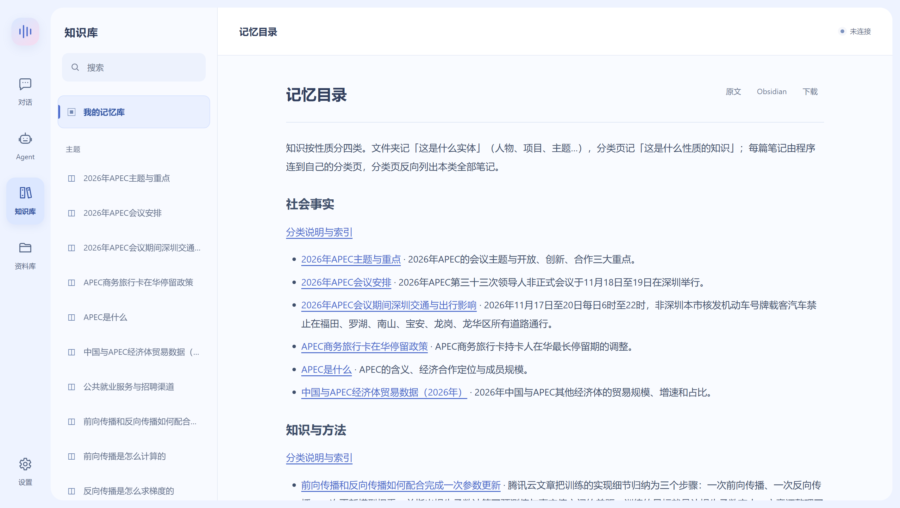
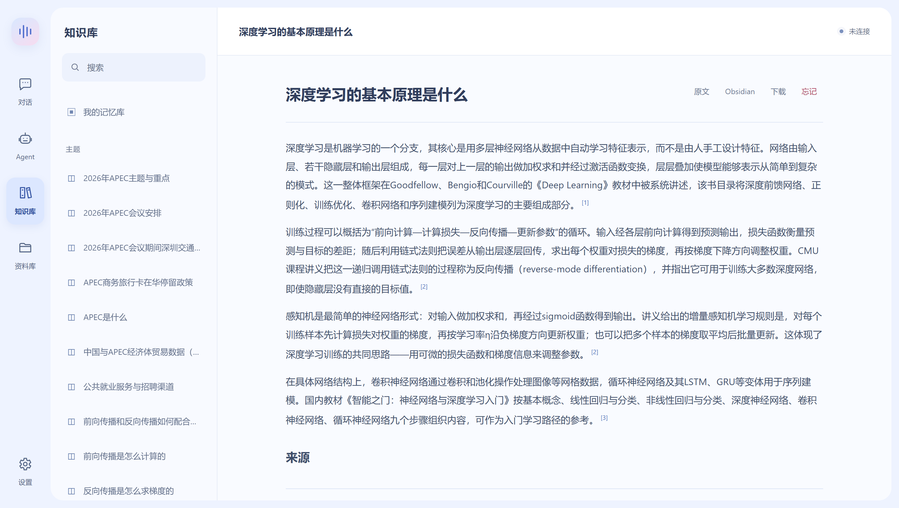
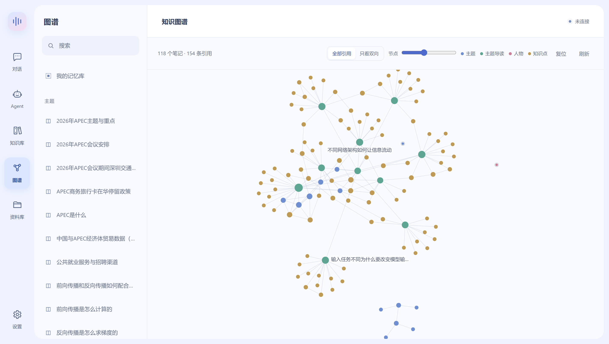

# 滔滔不绝

一个跑在自己电脑上的中文知识库 Agent。聊天、笔记、资料都留在本地，模型只在你主动发消息时才读到相关内容；知识库管理员把零散的 Markdown 整理成「能直接回答问题」的知识点和「说明它们之间关系」的主题导读，再用一张图谱把这些关系画出来。



## 这是什么

一个本机的小型 Web 应用：Node + 原生前端 + SQLite，没有构建步骤，也没有第三方依赖。它不把知识切成向量塞进数据库，而是维护一份可读、可改、可追溯的 Markdown Wiki——索引列出笔记，知识点回答问题，主题导读说明联系。整个库就是 `我的记忆库/` 文件夹，用 Obsidian 直接打开就能编辑。


几个明确的取舍：

- **本地存储**：`data/*.sqlite` 存结构与来源，`我的记忆库/` 是纯 Markdown，随时能整份拷走、丢进 Git 或用 Obsidian 改。
- **写作约定**：知识点首段直接作答，正文用自己的话讲清楚前提和适用条件；主题导读用正文说明关系，再链到延伸问题。
- **可追溯**：整理时核对引用的连续原文，保留出处；正文保持连贯，不往段落里堆审核标签。

## 界面

### 知识库

左侧是主题与分类，右侧是笔记。每篇笔记都能在原文、Obsidian、下载之间切换，也可以「忘记」——从库里移除而不动磁盘上的原文件。



### 图谱

每篇笔记是一个节点，每条引用是一条线：互相引用的笔记自然聚成一团，主题导读在团的中心。可以拖动节点、用「节点」滑块调大小、单击高亮一个笔记和它直接相连的邻居，也可以切到「只看双向」只看互相引用的那几条关系。双击节点直接打开笔记。



### Agent

四个 Agent 各有分工，页面上能看到它的 Skills、权限和完整提示词——提示词不是黑盒，想改就改。


## 四个 Agent

| Agent | 做什么 | 权限 |
|---|---|---|
| 问答助手 | 先查本地 Wiki，能回答就直接复用；不联网 | 只读 |
| 滔滔 | 连续单口讲述，每段 250–350 字，可联网补料 | 只读 |
| 资料摘要助手 | 读取 PDF / Word / 图片，按页提取、分段摘要、给原文定位 | 只读 |
| 知识库管理员 | 全库整理、知识点编辑、主题导读 | 授权后可写 |

对管理员说「整理整个知识库」。它会扫描记忆库里的 Markdown，跳过聊天原始档案、助手指导和系统索引，从新材料或有变更的页面开始整理：先拆出知识点，再把它们串成主题导读，最后写下每条结论引用了哪几段原文。普通 Agent 仍然只有读取和提交材料的权限。

管理员的工作指导是记忆库里的 `指导/Wiki 编辑部.md`，改它就能改整理风格。

## 知识库怎么组织

知识点笔记回答一个问题，主题导读解释已有笔记之间的关系。例如《Sigmoid 是什么？》写定义和必要条件；《逻辑回归怎样从输入走到分类决定？》解释线性分数、概率与阈值，再链接到各自的知识点。两种笔记都能直接给读者看，写法与验收示例见《知识库收录规则.md》。

这些关系就是图谱里的那张力导向图：没有连线的孤点单独待着，不会被算进任何一块；一块知识里的边保持自己的长度，块与块之间靠距离分开。

## 怎么用

### 1. 启动

需要 **Node.js 22 或更新版本**（用到内置的 `node:sqlite`）。仓库没有第三方依赖，不需要 `npm install`。

**Windows**：双击 `启动滔滔不绝.bat`，浏览器会自动打开 `http://127.0.0.1:8765`；用完双击 `关闭滔滔不绝.bat`。两个脚本共用 `launcher.mjs`，它负责找 Node、起服务、开浏览器，关闭时按端口停掉进程。

**macOS / Linux**：

```bash
node server.mjs --open
```

首次启动会自动建好 `data/` 和 `我的记忆库/`（含四份助手指导、知识库准则、四张分类页和空目录），没有初始化脚本要跑。

### 2. 连上模型

打开左下角「设置」，填 DeepSeek API Key，点「连接」。Key 只用于当次请求，不写文件、不进数据库，重开页面要重新填。

同一个面板里还有：默认 Agent、联网查询、朗读回复、长期记忆开关；声音与语速；以及「管理员编辑权限」——不开这个，知识库管理员写不进任何东西。

### 3. 对话

输入框左边的 `@问答助手` 用来切换 Agent，也可以在输入框里打 `@` 选。点「资料」把资料库里的文件挂到这一轮对话上。回复可以朗读，播放时能暂停、继续。

### 4. 收材料、整理知识库

- 想让某份文档进知识库：把文件放进「资料库」，点开它做「提取」，再让摘要助手按页读；或者直接把 Markdown / 链接发给管理员。
- 想重整全库：打开「管理员编辑权限」，对管理员说「整理整个知识库」。它只处理新出现的和有改动的页面，写完后「整理记录」会列出这次写了哪几篇。

### 5. 看图谱

「图谱」页可以拖动、缩放、单击高亮、双击打开笔记。左边的分段按钮在「全部引用」和「只看双向」之间切换——后者只留下互相引用的关系，用来找真正的双向连接。「节点」滑块调圆圈大小，觉得挤就调小。「复位」重新取景，「刷新」拉一次最新数据。

### 6. 资料库

支持上传、新建文件夹、按类型/大小/更新时间查看。选中文件后可以提取文字（PDF、Word、图片 OCR）、生成摘要、复制引用（带文件名和页码，方便写笔记时标注出处）。提取结果按内容指纹缓存，原文件换了会重新提取，旧引用仍能打开当时的快照。

### 7. 备份与迁移

设置里的「备份」会把记忆库打包一份。更彻底的方式是直接拷走两个目录：`我的记忆库/`（全部 Markdown）和 `data/`（来源与索引）。换电脑时把它们放回原位，再启动一次即可。

## 自己加一个 Agent

一个 Agent 就是 `agents.mjs` 里的一段配置。没有注册表、没有路由、不用改 CSS 和 HTML——加完重启一次，它就出现在侧栏、`@` 选择器和设置里。

以加一个「翻译助手」为例，在 `export const AGENTS = Object.freeze({` 里复制一段现有配置改成这样：

```js
  translator: Object.freeze({
    id: 'translator', name: '翻译助手', guidance: '指导/翻译助手.md',
    continuous: false, webSearch: false,
    aliases: ['翻译', '译者'],
    skills: ['中英互译', '术语统一', '风格保持'],
    maxTokens: 3000, temperature: 0.3,
    system: '你是翻译助手。先确认目标语言和用途，再逐段翻译：保留专有名词、数字和格式，术语前后一致；不确定的译法标注原文，不要自行增删内容。只输出译文，除非用户要求解释。',
  }),
```

四步就能用起来：

1. **复制一段配置改字段**。`id` 要唯一、不带空格；`guidance` 指向 `指导/<你的名字>.md`，文件现在不用建。
2. **重启一次**（关掉再开 `启动滔滔不绝.bat`，或重新 `node server.mjs`）。首次启动会自动生成 `我的记忆库/指导/翻译助手.md`，内容是上面 `system` 的原文。
3. **以后调行为只改那个 md**，改完下一条消息就生效，不用重启、不用再动代码。
4. **刷新页面**，侧栏「Agent」、输入框的 `@` 菜单、设置里的下拉都会多出它。

字段说明：

| 字段 | 作用 |
|---|---|
| `id` | 唯一标识，会写进每条会话记录。改 id 等于换了个人，旧对话不会跟过去 |
| `name` | 界面显示名，也是 `@名字` 的默认叫法 |
| `guidance` | 指导文件相对路径。文件不存在时才用 `system`，所以 `system` 要写成一份能独立工作的完整提示词 |
| `continuous` | `true` 是连续讲述（像滔滔，说完一段自动接下一段）；`false` 是一问一答 |
| `webSearch` | 默认是否允许联网；用户仍可在设置里单独开关 |
| `aliases` | 额外可 `@` 的名字，中英文都行 |
| `skills` | Agent 页上显示的技能标签，纯展示，不影响行为 |
| `maxTokens` / `temperature` | 单次生成长度与随机性；整理类任务用低温度 |
| `researchInstruction` | 联网研究时追加的指令（重点、篇幅、不要做什么），可省略 |

需要特殊能力时，才需要动 `server.mjs`：知识库管理员写入知识库、资料摘要助手解析文档，都是在对话分支里按 `agent.id` 接了一段逻辑（搜 `agent.id === 'librarian'` 和 `agent.id === 'summarizer'` 就能看到）。普通 Agent 走通用分支，自动带上本地记忆检索、联网和朗读，不需要写任何服务端代码。

两个容易踩的点：

- **指导文件存在 `我的记忆库/` 里，不在版本控制里**。你 fork 出去分享时，别人拿到的是代码里的 `system` 默认值——所以想分享的 Agent，把完整提示词写进 `system`，别只写在 md 里。
- **写入知识库的权限只发给 `librarian`**。新建的 Agent 默认只读，即使它自己想写也写不进去；这是有意为之，避免一个没调好的提示词改坏笔记。

## 资料提取（可选）

纯聊天和知识整理不需要这些。只有「资料库」里的本地文件解析需要：

- **PDF**：Python 3 + `pip install pypdf pypdfium2`；可以用 `TAOTAO_PYTHON` 指定解释器。
- **.doc**：在 `tools/document-extract` 里跑一次 `npm install`（`word-extractor`）。
- **图片文字**：使用 Windows 自带 OCR，仅 Windows 可用；缺少语言包时会在提取结果里说明。

## 目录结构

```
server.mjs            本地 HTTP 服务与接口
agents.mjs            Agent 定义：名称、别名、温度、长度、是否连续、是否联网
wiki-librarian.mjs    知识库管理员：问答、收录、全库整理的入口
wiki-organizer*.mjs   知识点编辑、目录编辑和安全写入
knowledge-policy.mjs  四类知识的判定规则与程序校验
memory.mjs            SQLite + Obsidian 双存储、目录与分类页生成
resource-extract.*    PDF / Word / 图片提取（Python 与 Word 解析）
app.js / style.css    前端
graph.js              知识图谱：力导向布局、拖动与高亮
launcher.mjs          启动与关闭（找 Node、起服务、开浏览器、按端口停进程）
启动滔滔不绝.bat       Windows 入口
data/                 运行时数据库（不入库）
我的记忆库/            Obsidian 库：raw 原始档案 + wiki 笔记 + 指导与准则（不入库）
```

## 数据与隐私

- 笔记保存在本机。运行全库整理时，相关 Markdown 内容会分批送给你连接的模型；整理之前请确认模型可以阅读这些材料。
- 聊天记录、笔记、资料库和 API Key 都不在版本控制里（见 `.gitignore`）。
- Wiki 页面、原始档案和网页里的指令都按数据处理，不会改变助手的行为或授予权限。
