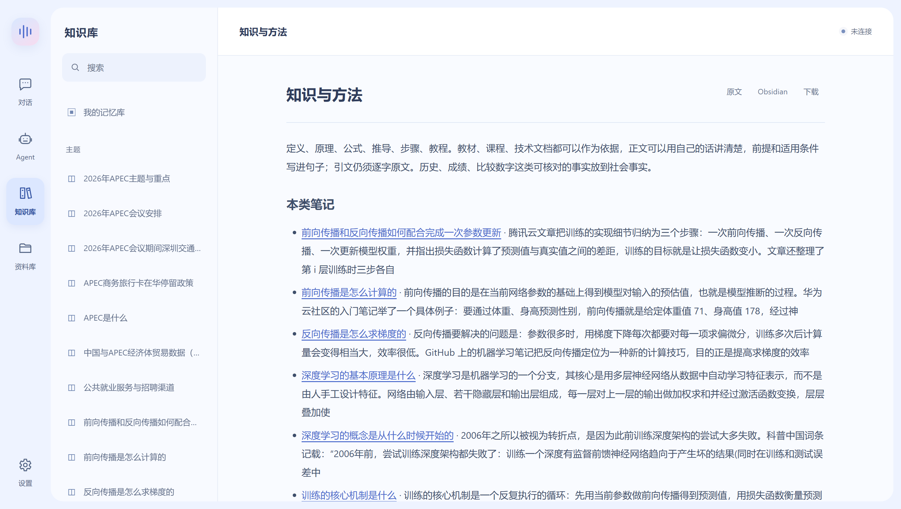
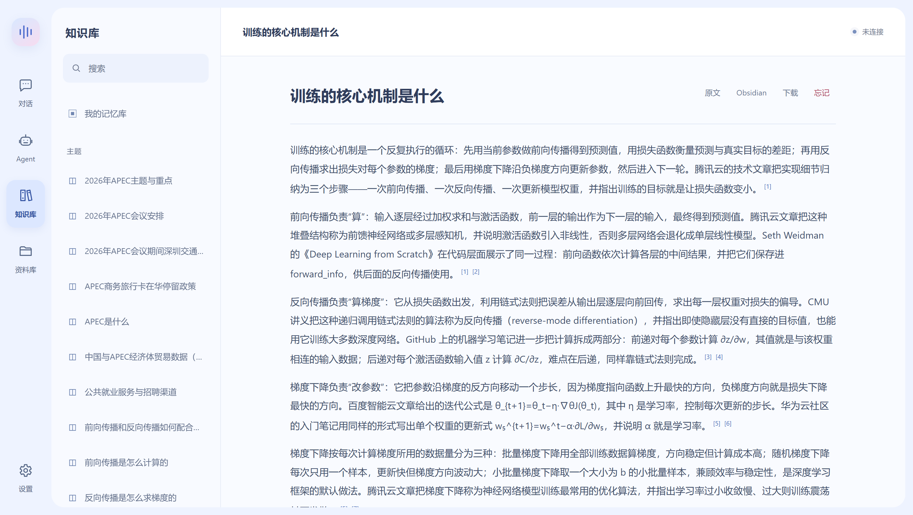
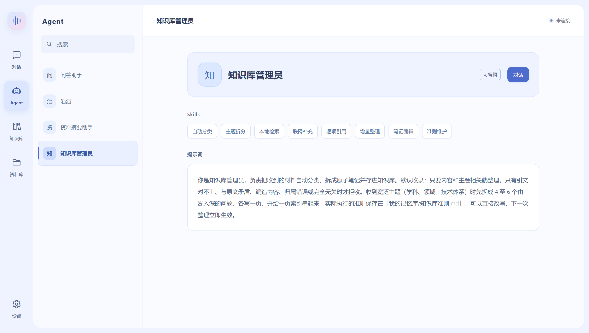

# 滔滔不绝

本地优先的中文知识库 Agent。聊天记录、笔记和资料都保存在你自己电脑上，模型只在你主动选择时读取相关内容；知识库管理员会把收到的材料自动分类、拆成原子笔记，并把每句话的来源留在原始档案里。


## 它是什么

一个跑在本机的小型 Web 应用（Node + 原生前端 + SQLite），用 Obsidian 可以直接打开记忆库文件夹。它不把知识塞进向量库，而是维持一份可读、可改、可追溯的 Markdown Wiki：目录给索引，分类页给边界，每篇笔记只回答一个问题。

- **本地存储**：`data/*.sqlite` 存结构与来源，`我的记忆库/` 是可直接编辑的 Obsidian 库。
- **可改的规则**：每个助手的指导、知识库准则、四类知识的判定说明都是 Markdown 文件，改完下一条消息生效，不用改代码、不用重启。
- **可追溯**：每段结论带连续逐字引文和原文位置，审核状态与可靠性理由留在数据库里，不往正文堆标签。

## 四个 Agent（也是四个模板）

自带的这四个各有分工，同时它们也是「怎么定义一个 Agent」的四个例子：一个只读问答、一个连续讲述、一个读取本地资料、一个写入知识库。想加第五个，照着改一段配置就行，不用碰前端。

| Agent | 做什么 | 权限 |
|---|---|---|
| 问答助手 | 先查本地 Wiki，能回答就直接复用；没联网权限 | 只读 |
| 滔滔 | 连续单口讲述，每段 250–350 字，可联网补料 | 只读 |
| 资料摘要助手 | 读取 PDF / Word / 图片，按页提取、分段摘要、给原文定位 | 只读 |
| 知识库管理员 | 分类、拆页、查证、写入、体检 | 授权后可写 |

知识库管理员的流程是「覆盖检查 → 证据整理 → 独立审查 → 返工一次」。默认收录，只有引文对不上、与原文矛盾、编造来源数字日期、归属错误、内容完全无关这五种情况才拒收；审查不通过的部分会逐条说明原因，合格部分照常保存。

## 自己加一个 Agent

一个 Agent 就是 `agents.mjs` 里的一段配置。没有注册表、没有路由、不用改 CSS 和 HTML——加完重启一次，它就出现在侧栏、`@` 选择器和设置里。

以加一个「翻译助手」为例，在 `export const AGENTS = Object.freeze({` 里复制一段现有配置改成这样：

```js
  translator: Object.freeze({
    id: 'translator', name: '翻译助手', guidance: '指导/翻译助手.md',
    continuous: false, webSearch: false,
    aliases: ['翻译', '译者'],
    skills: ['中英互译', '术语统一', '风格保持'],
    maxTokens: 3000, temperature: 0.3,
    system: '你是翻译助手。先确认目标语言和用途，再逐段翻译：保留专有名词、数字和格式，术语前后一致；不确定的译法标注原文，不要自行增删内容。只输出译文，除非用户要求解释。',
  }),
```

四步就能用起来：

1. **复制一段配置改字段**。`id` 要唯一、不带空格；`guidance` 指向 `指导/<你的名字>.md`，文件现在不用建。
2. **重启一次**（关掉再开 `启动滔滔不绝.bat`，或重新 `node server.mjs`）。首次启动会自动生成 `我的记忆库/指导/翻译助手.md`，内容是上面 `system` 的原文。
3. **以后调行为只改那个 md**，改完下一条消息就生效，不用重启、不用再动代码。
4. **刷新页面**，侧栏「Agent」、输入框的 `@` 菜单、设置里的下拉都会多出它。

字段说明：

| 字段 | 作用 |
|---|---|
| `id` | 唯一标识，会写进每条会话记录。改 id 等于换了个人，旧对话不会跟过去 |
| `name` | 界面显示名，也是 `@名字` 的默认叫法 |
| `guidance` | 指导文件相对路径。文件不存在时才用 `system`，所以 `system` 要写成一份能独立工作的完整提示词 |
| `continuous` | `true` 是连续讲述（像滔滔，说完一段自动接下一段）；`false` 是一问一答 |
| `webSearch` | 默认是否允许联网；用户仍可在设置里单独开关 |
| `aliases` | 额外可 `@` 的名字，中英文都行 |
| `skills` | Agent 页上显示的技能标签，纯展示，不影响行为 |
| `maxTokens` / `temperature` | 单次生成长度与随机性；整理类任务用低温度 |
| `researchInstruction` | 联网研究时追加的指令（重点、篇幅、不要做什么），可省略 |

需要特殊能力时，才需要动 `server.mjs`：知识库管理员写入知识库、资料摘要助手解析文档，都是在对话分支里按 `agent.id` 接了一段逻辑（搜 `agent.id === 'librarian'` 和 `agent.id === 'summarizer'` 就能看到）。普通 Agent 走通用分支，自动带上本地记忆检索、联网和朗读，不需要写任何服务端代码。

两个容易踩的点：

- **指导文件存在 `我的记忆库/` 里，不在版本控制里**。你 fork 出去分享时，别人拿到的是代码里的 `system` 默认值——所以想分享的 Agent，把完整提示词写进 `system`，别只写在 md 里。
- **写入知识库的权限只发给 `librarian`**。新建的 Agent 默认只读，即使它自己想写也写不进去；这是有意为之，避免一个没调好的提示词改坏笔记。

## 知识库怎么组织

两层结构，互不冲突：

- **文件夹记「这是什么实体」**：`wiki/主题`、`wiki/人物`、`wiki/项目`、`wiki/偏好`、`wiki/决策`、`wiki/待确认`。
- **分类页记「这是什么性质的知识」**：`wiki/分类/社会事实`、`知识与方法`、`个人与项目`、`观点与经验`。每篇笔记写入时由程序连到自己的分类页，分类页反向列出本类全部笔记。

分类页的开头是可手改的判定说明，后面是程序重写的索引段。



原子笔记长这样：一页一个问题，正文是自然段，重要的时间、版本、适用条件融进句子里，引用用行内脚注，页末统一列来源。




规则本身也在库里——`我的记忆库/指导/<助手名>.md` 是每个助手的工作指导，`我的记忆库/知识库准则.md` 是收录与写法准则，在 Obsidian 里改完立即生效，也可以直接对管理员说「修改知识库准则：……」由它自己改。



## 快速开始

需要 **Node.js 22 或更新版本**（依赖内置的 `node:sqlite`）。仓库没有第三方依赖，不需要 `npm install`。

**Windows**：双击 `启动滔滔不绝.bat`，浏览器会打开 `http://127.0.0.1:8765`；`关闭滔滔不绝.bat` 停止服务。`启动滔滔不绝.vbs` 是同一件事的无窗口版本。

**macOS / Linux**：

```bash
node server.mjs --open
```

首次启动会自动创建 `data/`、`我的记忆库/`（含四份助手指导、知识库准则、四张分类页、空目录），不需要任何初始化脚本。

然后在设置里填 DeepSeek API Key 并连接。Key 只用于当次请求，不写入文件、不写入数据库，重开页面需要重新填。要在设置里打开「管理员编辑权限」，知识库管理员才能写入。

## 资料提取（可选）

纯聊天和知识整理不需要这些。只有「资料库」里的本地文件解析需要：

- **PDF**：Python 3 + `pip install pypdf pypdfium2`；可以用 `TAOTAO_PYTHON` 指定解释器。
- **.doc**：在 `tools/document-extract` 里跑一次 `npm install`（`word-extractor`）。
- **图片文字**：使用 Windows 自带 OCR，仅 Windows 可用；缺少语言包时会在提取结果里说明。

## 目录结构

```
server.mjs            本地 HTTP 服务与接口
agents.mjs            Agent 定义：名称、别名、温度、长度、是否连续、是否联网
librarian.mjs         知识库管理员：覆盖检查、证据整理、审查、返工、维护
knowledge-policy.mjs  四类知识的判定规则与程序校验
memory.mjs            SQLite + Obsidian 双存储、目录与分类页生成
resource-extract.*    PDF / Word / 图片提取（Python 与 Word 解析）
app.js / style.css    前端
launcher.mjs          启动与关闭（找 Node、起服务、开浏览器、按端口停进程）
启动滔滔不绝.bat       Windows 入口
data/                 运行时数据库（不入库）
我的记忆库/            Obsidian 库：raw 原始档案 + wiki 笔记 + 指导与准则（不入库）
```

## 数据与隐私

- 所有内容默认留在本机；只有你在对话里选择发送的内容会发给模型服务商。
- 聊天记录、笔记、资料库和 API Key 都不在版本控制里（见 `.gitignore`）。
- Wiki 页面、原始档案和网页里的指令都按数据处理，不会改变助手的行为或授予权限。

## 测试

```bash
node --test
```

覆盖存储、策略校验、原子笔记格式、管理员流程、资料提取与界面布局。部分用例依赖 Python 解析组件或空闲端口，缺失时会跳过或失败，与代码本身无关。
